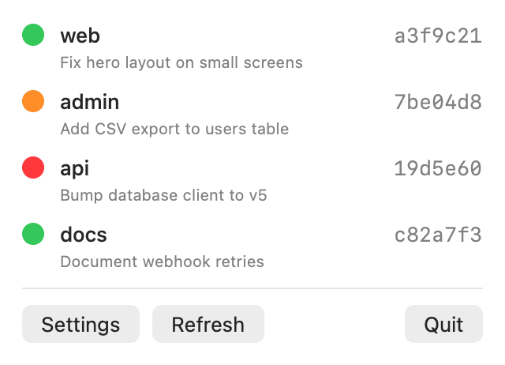

# vercel-watch

A tiny macOS menu bar app that shows the status of your latest Vercel production deploys.



- One row per watched project: coloured status circle, project name, short commit hash
- Green = ready, orange = building/queued, red = error, grey = unknown
- Commit message shown under each row
- Click a row to open the deployment in Vercel
- Refreshes every 30 seconds
- Configurable menu bar logo (triangle, circle, pill, status dot, or your own image)

Single-file SwiftUI app, no dependencies.

## Build

Requires macOS 13+ and Xcode.

```sh
./build.sh
open VercelWatch.app
```

`build.sh` calls Xcode's `swiftc` directly and produces an ad-hoc signed, menu-bar-only app bundle. To start it at login, add it under System Settings → General → Login Items.

## Setup

1. Create a token at <https://vercel.com/account/tokens>. Scope it to the team that owns your projects.
2. Click the menu bar icon → **Settings**.
3. Enter the token, the project names to watch (comma separated), and a team ID (`team_...`) if the projects belong to a team.

The token is stored in the macOS Keychain. Other settings are stored in UserDefaults.

## Notes

- Only **production** deployments are checked. Canceled deployments are skipped, since Vercel cancels builds superseded by newer pushes.
- The commit hash and message come from the deployment's git metadata, so deploys not triggered from git fall back to the deployment ID and show no message.
- `tools/icon.swift` generates the app icon (`Resources/AppIcon.icns`).
